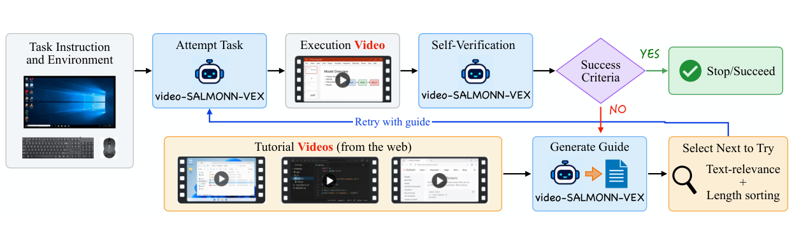

# Video-as-Experience: Learning Computer Use via Audio-Visual Understanding

**VEX** unifies learning from tutorial videos and reflecting on an agent's own execution through a **watch–act–rewatch** framework.

[🧭 Overview](#overview) · [📊 Results](#results) · [📦 Release](#release) · [🗂️ Code](#code) · [📚 Data](#data-and-examples) · [🚀 Training](#training) · [🧪 Evaluation](#evaluation-and-verification)

> This branch contains the Qwen3.5 implementation. The previous Qwen3-VL release is preserved on [`vex_qwen3vl`](https://github.com/TomZ1412/VideoCUA/tree/vex_qwen3vl).

<a id="abstract"></a>

## 📝 Abstract

Multimodal large language models (LLMs) have enabled capable computer-use agents that perceive graphical user interfaces, reason over instructions, and execute actions. However, existing approaches to learning from video demonstrations typically convert videos into screenshot-based action trajectories, rather than directly leveraging their rich audio-visual information. We introduce VEX (Video as EXperience), a framework that uses audio-visual understanding to unify learning from external demonstrations and reflecting on an agent’s own behavior. Following a watch-act-rewatch paradigm, the agent extracts procedural guidance from tutorial videos containing visual demonstrations and spoken explanations, executes tasks, and verifies its progress by rewatching its execution as video. We instantiate VEX with video-SALMONN-VEX, a 9B-scale audio-visual computer-use agent built on the video-SALMONN 2 architecture with a Qwen3.5-9B backbone. We further introduce Action-Grounded Guide Optimization (AGGO), a reinforcement learning method that optimizes video-derived guidance for downstream action prediction, and augment AgentNet, OSWorld, and CUA-Gym with over 24K real-world tutorial videos. Experiments on OSWorld and a complementary subset of CUA-Gym demonstrate consistent improvements, with video-SALMONN-VEX achieving a 22% relative increase in task success over its Qwen3.5 backbone on OSWorld. Moreover, its generated guidance improves Gemini-3.5-flash by 10% relatively on OSWorld. These results highlight the potential of audio-visual understanding as a unified interface for procedural learning and self-verification in computer-use agents.

<a id="overview"></a>

## 🧭 Overview



VEX extracts task-relevant procedural guidance from tutorial videos, executes computer-use tasks, and verifies progress from narrated execution videos. **Action-Grounded Guide Optimization (AGGO)** trains separate guidance and action LoRA adapters using downstream action-likelihood rewards. At inference time, verification supports stopping and selecting among repeated attempts.

<a id="results"></a>

## 📊 Results

Task success rate (%) from Tables 2–3 of the paper:

| Model | OSWorld-Verified | CUA-Gym (220 tasks) |
|---|---:|---:|
| Qwen3-VL (8B) | 36.52 | 11.87 |
| Qwen3.5 (9B) | 41.15 | 18.33 |
| Qwen3.5 + trajectory | 43.98 | 21.25 |
| video-SALMONN 2 | 42.70 | 17.23 |
| video-SALMONN 2 SFT | 43.46 | 19.34 |
| video-SALMONN 2 SFT @ 3 trials | 45.65 | 20.29 |
| **video-SALMONN-VEX** | **49.99** | **26.26** |

Guidance transfer to Gemini-3.5-flash (Table 7):

| Setting | OSWorld | CUA-Gym |
|---|---:|---:|
| Standard Gemini-3.5-flash | 61.69 | 47.13 |
| VEX with Gemini guidance | 67.38 | 52.70 |
| **VEX with video-SALMONN-VEX guidance** | **68.67** | **52.34** |

These are the paper's reported results, not new measurements from this code release.

<a id="release"></a>

## 📦 Release

- [x] Qwen3.5 audio-visual model and dual-LoRA AGGO code
- [x] Action-SFT, description-SFT, AGGO and verifier launchers
- [x] OSWorld and CUA-Gym execution harnesses
- [x] Guidance extraction, trajectory video rendering and verification code
- [x] Task-to-video-ID metadata and real-source format examples
- [ ] Model checkpoints — **will be published later**

<a id="code"></a>

## 🗂️ Code

```text
VideoCUA/
├── assets/                         # Framework figure from the paper
├── example/                        # 1–2 real-source records per format
├── metadata/                       # Task ID → tutorial video IDs
├── requirements.txt
└── vex_code/
    ├── scripts/                    # Benchmark launch configurations
    ├── scorer/                     # Trial selection and aggregation
    ├── vsvex_train/                # SFT and AGGO launchers
    │   └── qwen35_cua_multirl_dualora/
    ├── vsvex_inference/             # Guidance, agents and benchmark runners
    │   └── verification/           # Narration and execution-video tools
    └── vsvex_verifier/              # VS2 verifier (Qwen3.5 backbone)
```

See [`vex_code/README.md`](vex_code/README.md) for the execution order and configuration. No weights, full training annotations, benchmark results, logs or media datasets are included.

<a id="installation"></a>

## 🛠️ Installation

Use Linux with NVIDIA GPUs and Python 3.11+. Install a CUDA-compatible PyTorch stack, then the dependencies:

```bash
python -m pip install -r requirements.txt
cd vex_code/vsvex_train/qwen35_cua_multirl_dualora
python -m pip install -e . --no-deps --no-build-isolation
```

The custom Qwen3.5 implementation needs compatible Transformers, TorchCodec and model dependencies. Guidance decoding additionally uses vLLM; narration uses Kokoro and system `ffmpeg`/`ffprobe`. Install OSWorld and CUA-Gym independently and configure their task bundles and VM/provider environments. See the component READMEs for details.

<a id="data-and-examples"></a>

## 📚 Data and examples

The metadata contains video identifiers, **not local paths or generated descriptions**:

- [`metadata/opencua_task_to_video.json`](metadata/opencua_task_to_video.json)
- [`metadata/osworld_task_to_video.json`](metadata/osworld_task_to_video.json)
- [`metadata/cuagym_task_to_video.json`](metadata/cuagym_task_to_video.json) — restricted to the 220-task subset

See [`metadata/README.md`](metadata/README.md) for the format and counts. Media and complete training annotations are distributed separately; checkpoint links will be added when available.

[`example/`](example/) contains one or two records extracted from real experiment files for action SFT, description SFT, AGGO, task configurations, guidance extraction, descriptions and verification. Only machine-specific media paths are replaced with placeholders. The examples illustrate data formats, not full datasets; verification.json shows actual verifier outputs.

<a id="training"></a>

## 🚀 Training

Configure paths through environment variables and use the provided launchers:

```bash
export MODEL_PATH=YOUR_QWEN35_MODEL_PATH
export MODEL_BASE=YOUR_PROCESSOR_PATH
export LORA_CKPT=YOUR_INITIALIZATION_ADAPTER_PATH
export TRAIN_DATA=YOUR_TRAIN_JSON_PATH
export VALIDATION_DATA=YOUR_VALIDATION_JSON_PATH

bash vex_code/vsvex_train/sft_action.sh
# Configure the description training inputs, then:
bash vex_code/vsvex_train/sft_desc.sh
# Configure the action/guide SFT adapters and AGGO inputs, then:
export LORA_CKPT_2=YOUR_GUIDE_SFT_ADAPTER_PATH
bash vex_code/vsvex_train/aggo.sh
```

See [`vsvex_train/README.md`](vex_code/vsvex_train/README.md) for stage-specific inputs and defaults. The audio-aligned base, initialization adapter, SFT checkpoints and final AGGO weights **will be published later**.

<a id="evaluation-and-verification"></a>

## 🧪 Evaluation and verification

1. Extract tutorial guidance with the existing training `test.sh`, selecting `adapter_2`.
2. Prepare a task-to-guidance JSON mapping from the decoding outputs.
3. Run OSWorld/CUA-Gym with the [`benchmark launchers`](vex_code/scripts/), selecting `adapter_1` for action prediction.
4. Collect trajectories and render narrated videos using [`verification/`](vex_code/vsvex_inference/verification/).
5. Score with [`run_verifier.sh`](vex_code/vsvex_verifier/run_verifier.sh), then select trials using [`scorer/`](vex_code/scorer/).

The verifier uses **VS2 with a Qwen3.5 backbone**, including its Whisper/audio projection components. Load the audio-aligned VS2 base with its compatible caption adapter, or a fully merged VS2 checkpoint. Native Qwen3.5 weights are not used for this verifier. Verification and trial selection operate offline over generated rollouts.

<a id="license"></a>

## 📄 License

[Apache License 2.0](LICENSE). Existing upstream copyright and license notices are retained.

